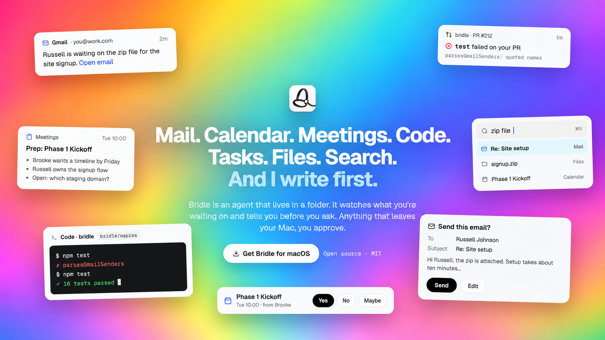
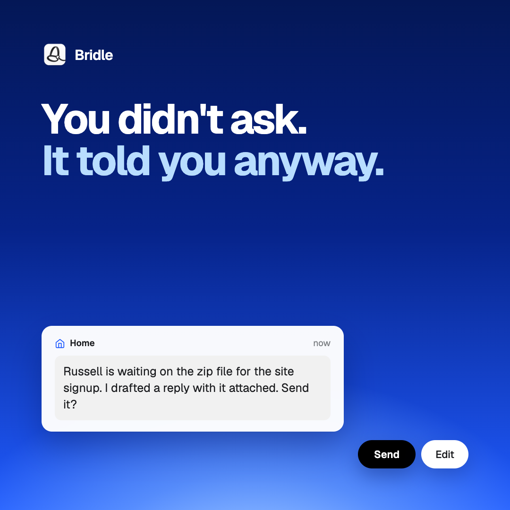
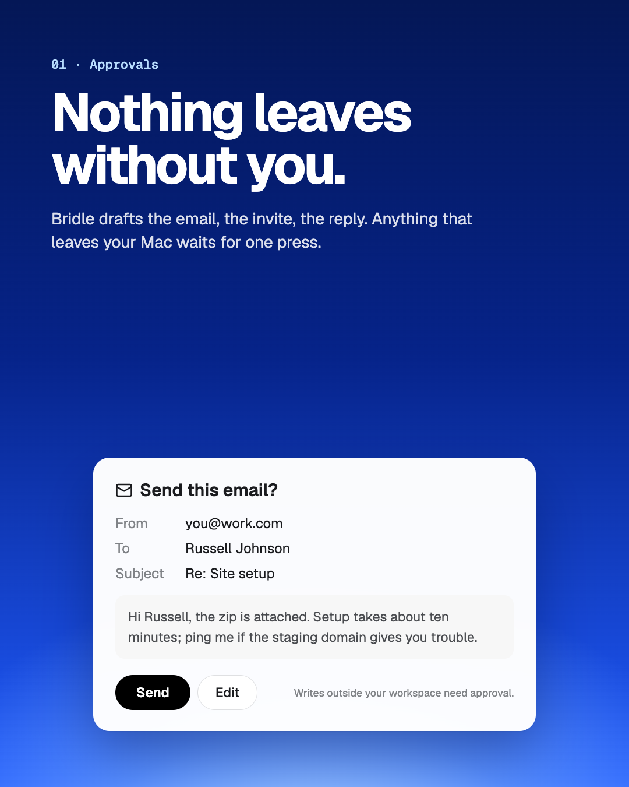
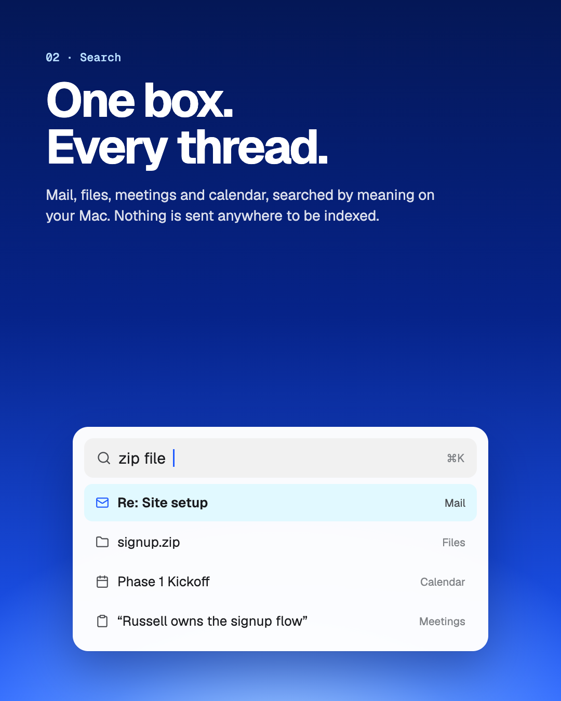
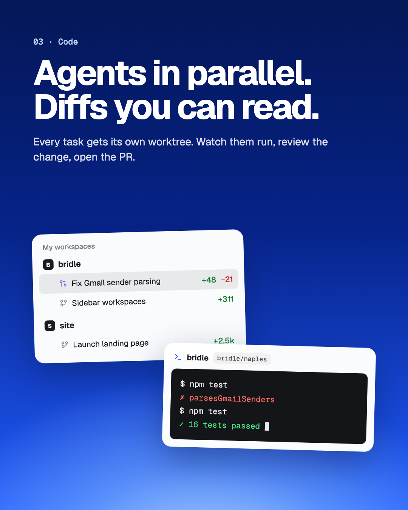

<p align="center">
  
</p>

<h1 align="center">Bridle</h1>

<p align="center">
  <strong>An open-source personal agent for macOS that lives in a folder and writes first.</strong>
</p>

<p align="center">
  <a href="https://github.com/CreatorHive/bridle/actions/workflows/ci.yml"></a>
  <a href="LICENSE"></a>
  
  
</p>

<p align="center">
  <a href="https://github.com/CreatorHive/bridle/releases/latest"><strong>Download</strong></a> ·
  <a href="#run-it">Run it</a> ·
  <a href="#what-it-does">What it does</a> ·
  <a href="#your-workspace-is-just-a-folder">The workspace</a> ·
  <a href="docs/architecture.md">Architecture</a>
</p>

---



Most assistants wait to be asked. Bridle reads what's new in your mail, calendar and GitHub, notices what someone
is waiting on you for, and tells you first, with the next step already drafted:

> Russell is waiting on the zip file for the site signup. I drafted a reply with it attached. Send it?

You press **Send** or **Edit**. Nothing leaves your Mac without that press.

Everything Bridle knows lives in one plain folder on your Mac: its persona and memory, your chats, tasks, notes and
files. You can open it in Finder, grep it, or put it in git. Deleting the search index just rebuilds it.

<br clear="right">

## What it does

<table>
  <tr>
    <td width="33%"></td>
    <td width="33%"></td>
    <td width="33%"></td>
  </tr>
  <tr>
    <td valign="top"><strong>Approvals.</strong> Bridle drafts the email, the invite, the reply. Edits inside the workspace are instant; sending, scheduling, deleting and running commands wait for your OK.</td>
    <td valign="top"><strong>Search.</strong> One ⌘K box over mail, files, meetings and calendar, searched by meaning. OCR, transcription and embeddings run on your Mac.</td>
    <td valign="top"><strong>Code.</strong> Every task gets its own git worktree. Watch agents run in parallel, read the diff, open the PR.</td>
  </tr>
</table>

| | |
|---|---|
| 🏠 **Home** | Bridle writes first when someone is blocked on you, an invite needs an answer, or a check failed on your PR. A morning briefing, and prep notes before meetings. |
| ✉️ **Mail and Calendar** | Your Gmail and Google Calendar accounts in one place, with replies and RSVPs drafted for you to approve. |
| 📋 **Board** | Tasks in Backlog, In progress, Needs review and Done, plus your Linear issues. Press **Run with Bridle** and it works the task until it's done or needs you. |
| 🔁 **Routines and Loops** | "Every weekday at 8, tell me what's on." Loops watch something with a tiny script and wake the agent only when it changes, so a quiet hour costs no tokens. |
| 📁 **Files and Drive** | Recent files by kind, and a Drive of your own folders that Bridle can read and organize. |
| 💬 **Side chat and the notch** | ⌘⇧Space opens a chat over any app. The notch shows what Bridle is working on and what's waiting on you. |
| 🔌 **Your models and tools** | Claude through Claude Code by default, or any OpenAI-compatible endpoint (OpenRouter, Ollama, LM Studio). Gmail, Calendar, GitHub and Linear through Composio. Add your own MCP servers. |

## Your workspace is just a folder

```
~/Bridle/
├── AGENTS.md  SOUL.md  IDENTITY.md  USER.md     who the agent is and who you are, read every turn
├── MEMORY.md  memory/2026-10-09.md               what it remembers, and today's log
├── HEARTBEAT.md                                  when it's worth writing to you first
├── chats/            one JSONL file per conversation
├── tasks/            the board, one markdown file per task
├── routines/         things to do on a schedule
├── loops/            cheap watchers: LOOP.md + check.sh
├── notes/  meetings/ notes and meeting prep
├── drive/            your own folders and files
└── .bridle/          Bridle's state: search index, settings it guards
```

The agent edits its own files freely. It asks before touching `.bridle/` or anything outside the workspace, and text
it reads in mail, web pages and files is treated as data, never as instructions. See the
[safety model](docs/architecture.md#safety-model).

## Status

Bridle is early. Expect rough edges:

- Email and event cards that appear under a reply don't send yet. Sending works through the agent's Gmail and
  Calendar tools, which ask you first.
- Routines, Loops and task runs work while Bridle is open.

## Run it

You'll need:

- macOS. The on-device features (search by meaning, OCR, transcription, dictation, the notch) need macOS 26 and Xcode 26.
- Node.js 20 or later.
- [Claude Code](https://claude.com/claude-code), signed in, for the default model. Or point Settings → Models at an
  OpenAI-compatible endpoint.
- Optional: a [Composio](https://composio.dev) API key for Gmail, Google Calendar, GitHub and Linear
  (Settings → Connections).

**Download:** the latest signed and notarized DMG is on
[Releases](https://github.com/CreatorHive/bridle/releases/latest) (Apple silicon, macOS 26 or later).

**Or run it from source:**

```sh
git clone https://github.com/creatorhive/bridle.git
cd bridle
npm install
npm run build:native   # optional: the on-device features above
npm run dev
```

Bridle creates `~/Bridle` on first launch and walks you through setup.

| Command | What |
|---|---|
| `npm run dev` | The app with hot reload for the window. Changes to `src/main` or `src/preload` need a restart. |
| `npm run build` | Builds `out/main`, `out/preload`, `out/renderer`. |
| `npm start` | Runs the built app. |
| `npm run typecheck` | `tsc` for main/preload/shared and for the renderer. |
| `npm test` | vitest. |
| `npm run build:native` | The Swift helpers: `bridle-helper` and `bridle-notch`. |
| `npm run dist` | A signed DMG in `dist/` (uses the Developer ID in your keychain; notarizes when Apple credentials are set). |
| `npm run rebuild` | Rebuilds `node-pty` for Electron (`postinstall` already tries). |

Logs go to `~/Library/Logs/Bridle/bridle.log`.

<details>
<summary><strong>Without the native helper</strong></summary>

Everything still runs: search is by words only, images and audio aren't indexed until the helper is built, Files
shows kind icons instead of thumbnails, dictation explains how to build it, and there's no notch.

</details>

<details>
<summary><strong>Troubleshooting</strong></summary>

`node-pty` didn't build: Code terminals fall back to `script(1)`. Run `npm run rebuild` (and again after an Electron
upgrade).

On Node 24, Electron's postinstall can stop before it finishes unzipping (`Electron failed to install correctly`):

```sh
Z=$(find ~/Library/Caches/electron -name 'electron-v33.4.11-darwin-*.zip' | head -1)
rm -rf node_modules/electron/dist && mkdir node_modules/electron/dist && unzip -q "$Z" -d node_modules/electron/dist
printf 'Electron.app/Contents/MacOS/Electron' > node_modules/electron/path.txt
```

</details>

## How it's built

Electron 33, electron-vite, React 18, TypeScript (strict) and vitest, with CSS modules and no UI kit. Runtime
dependencies are deliberately few: `cuelume` (interface sounds), `lucide-react` (icons), `node-sqlite3-wasm` (the
search index), and `node-pty` with `@xterm/xterm` (Code terminals). Two small Swift processes in
`native/BridleHelper` reach the Apple frameworks Electron can't. The website is in `site/`.

[docs/architecture.md](docs/architecture.md) covers the layout, the IPC contract, the safety model and the on-disk
formats.

## License

[MIT](LICENSE) © Sean Scott
